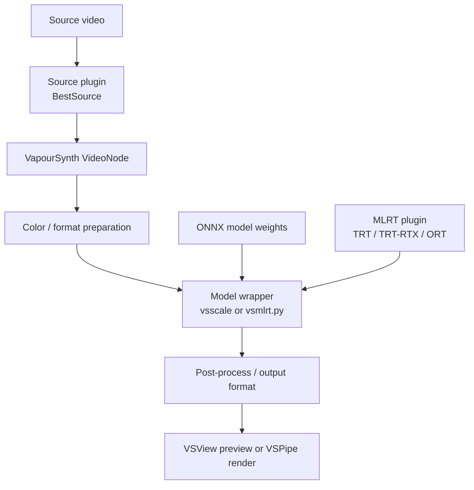

# Start here

VapourSynth is a frame-based video processing engine. You write a Python script describing how a source video is decoded, transformed and exposed as one or more output clips. A previewer or renderer then requests frames from that script.

The AI path adds two more ingredients: a **runtime plugin** that can execute a network and an **ONNX model file** containing the network weights.

## The pipeline at a glance

## What each component does

| Component | Responsibility | Example in this guide |
|---|---|---|
| Python | Runs the `.vpy` script and imports VapourSynth modules. | Python 3.14.10 x64 |
| VapourSynth core | Owns clips, frames, formats, filters and output nodes. | `vapoursynth` / `vs.core` |
| Source plugin | Reads video frames into VapourSynth. | BestSource (`core.bs`) |
| JET | Python utilities and higher-level filtering/scaling interfaces. | `vssource`, `vstools`, `vsscale` |
| MLRT plugin | Runs a supported AI network on a chosen runtime. | `core.trt`, `core.trt_rtx`, `core.ort` |
| Wrapper | Maps convenient Python functions to a model/runtime. | `GenericOnnxScaler`, `vsmlrt.py` |
| ONNX model | The network architecture and trained weights. | AnimeJaNai, Waifu2x, RIFE |
| Preview / renderer | Requests frames from a `.vpy` script. | VSView, VSPipe |

## Upscaling is not interpolation

  

    SPATIAL PROCESSING
    <h3>Upscaling</h3>
    
Changes each frame's dimensions. Example: 1920 × 1080 → 3840 × 2160 (2×).

    
<strong>Models:</strong> AnimeJaNai, Waifu2x, RealESRGAN, CUGAN.

  

  

    TEMPORAL PROCESSING
    <h3>Frame interpolation</h3>
    
Creates estimated frames between existing frames. Example: 23.976 → 47.952 fps.

    
<strong>Model:</strong> RIFE.

  

## Two MLRT usage styles in this environment

### JET-native scaling

The AnimeJaNai example uses `vsscale.GenericOnnxScaler` and `vsscale.mlrt.Backend`. It is a good fit for an ONNX model whose input/output contract is compatible with the generic scaler.

### AmusementClub model wrappers

The local `vsmlrt.py` file exposes model-aware functions such as `Waifu2x` and `RIFE`. These wrappers know model-specific details that a generic ONNX scaler may not know. The audited machine contains a custom API-4-adapted wrapper, so inspect its local version and signatures before copying examples from a different upstream revision.

!!! important "Do not mix wrapper revisions"
    The upstream `vsmlrt.py` source and the local `4.1.1+api4.jetfix2` file are not interchangeable by assumption. Their APIs may differ. Keep the wrapper version, model pack and scripts aligned.

## Recommended learning path

1. [Check prerequisites](prerequisites.md).
2. [Install the environment](../installation/windows.md).
3. [Verify the installation](../installation/verification.md).
4. Run [AnimeJaNai 2×](../models/animejanai.md) on a short clip.
5. Try [Waifu2x](../models/waifu2x.md) or [RIFE](../models/rife.md) for their specific jobs.
6. [Preview and render](../workflows/preview-and-render.md).
